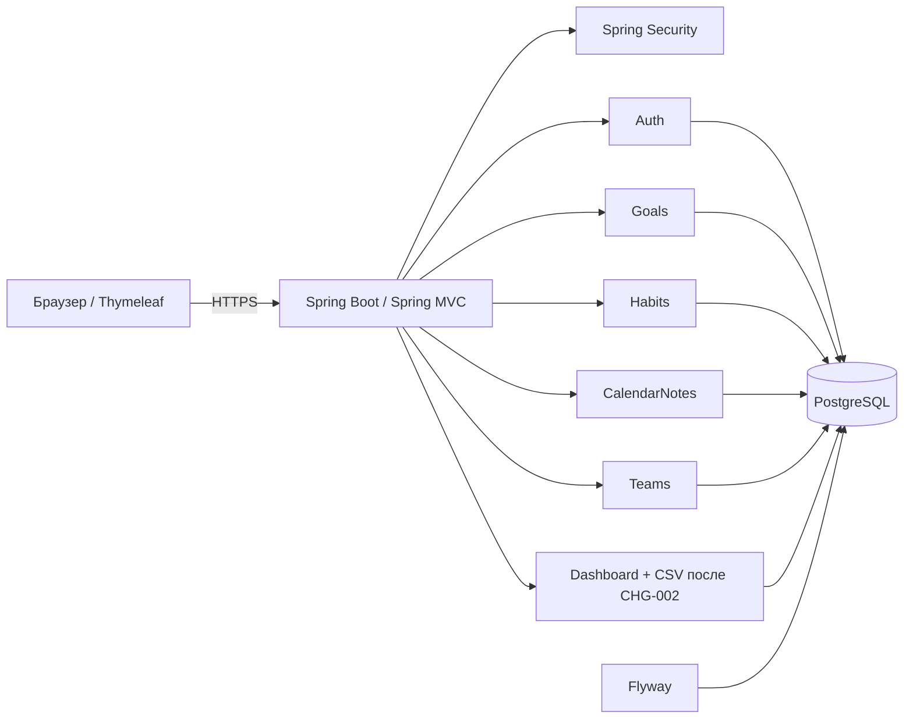

# Software Design Description — FocusFlow

**Версия:** учебный проект ЛР4; основа — SRS ЛР3. **Статус:** проектирование, не отчет о готовой реализации.

## 1. Назначение и границы
FocusFlow — адаптивное веб-приложение для личной и командной продуктивности: цели, привычки, события, заметки, командные пространства и панель дня. Исходный объем версии 1.0 не включает интеграции с календарями, push/e-mail, платежи, отдельный mobile app, ИИ и экспорт. CSV вошёл в учебный план только по CHG-002.

## 2. Архитектура
Выбран **модульный монолит**, server-side MVC. Браузер (HTML/CSS и Thymeleaf) → Java 25 / Spring Boot / Spring MVC / Spring Security → Spring Data JPA → PostgreSQL. Maven — сборка, Flyway — миграции, Actuator — эксплуатационные показатели. Единое развертывание без отдельного SPA и платных сторонних API.

## 3. Разделение по модулям
| Модуль | Ответственность | Основные элементы |
|---|---|---|
| Auth | Регистрация, вход, сессия, текущий пользователь | User, SecurityConfig |
| Goals | Личные/общие цели, прогресс, архив | Goal, GoalService |
| Habits | Расписание, отметки выполнения | Habit, HabitCheck |
| CalendarNotes | События и личные заметки | CalendarEvent, Note |
| Teams | Команды, участники, приглашения, OWNER/MEMBER | Team, Membership, Invite |
| Dashboard | Панель дня, агрегаты, CSV по CHG-002 | DashboardDTO, CsvService |
| Operations | Миграции, журналы, health, резервирование | Flyway, Actuator |

## 4. Модель данных
| Сущность | Ключевые поля | Ограничения |
|---|---|---|
| User | id, email, passwordHash, enabled | email UNIQUE, BCrypt |
| Goal | id, ownerId, teamId?, title, progress, archived | progress 0–100, FK |
| Habit | id, ownerId, weekdays | маска дней, FK |
| HabitCheck | habitId, date | UNIQUE(habitId, date), FK |
| Event | id, ownerId, teamId?, startsAt, endsAt | валидация дат, FK |
| Note | id, ownerId, title, body | личный доступ |
| Team | id, ownerId | владелец |
| TeamMember | teamId, userId, role | UNIQUE(teamId,userId), OWNER/MEMBER |
| Invite | id, teamId, inviteeId, status, token | уникальный token, FK |

Связи: User владеет Goal/Habit/Event/Note; Habit содержит HabitCheck; Team имеет TeamMember и Invite; общие Goal/Event связаны с Team. Конкретные SQL-миграции должны появиться на этапе реализации.

## 5. HTTP-интерфейсы
- `GET/POST /register`, `/login` — регистрация/авторизация.
- `GET /dashboard` — личная сводка дня.
- `GET/POST /goals`, `/habits`, `/events`, `/notes` — соответствующие веб-операции (дополнительные URL редактирования/удаления определяются при реализации).
- `POST /habits/{id}/checks` — отметка привычки.
- `GET/POST /teams`, `POST /teams/{id}/invites`, `POST /teams/{id}/accept`, `GET /teams/{id}/goals` — команды.
- `GET /exports/progress.csv` — выгрузка после CHG-002.

После POST — Post/Redirect/Get. Сервер валидирует ввод и права независимо от интерфейса.

## 6. Транзакции и безопасность
- Spring Security: безопасная сессия; пароль BCrypt cost ≥ 12; HTTPS; CSRF; HTML-экранирование.
- Каждое чтение и изменение данных проверяет `ownerId` либо членство и роль в `teamId`. Наличие корректного URL или знания ID не дает права доступа.
- Личные привычки/заметки не раскрываются участникам команд.
- Создание Team вместе с OWNER/членством — одна транзакция.
- Отметка HabitCheck — одна транзакция с UNIQUE(habitId, date), устойчивость к повторному POST.
- CSV: только данные аутентифицированного владельца, UTF-8, корректное экранирование CSV, защита от CSV formula injection.

## 7. Качество, развертывание и проверки
- 95% запросов страниц ≤ 2 с при 50 одновременных пользователях; панель ≤ 2 с при 1000 объектах.
- Доступность ≥ 99% в месяц (кроме плановых работ); ежедневные бэкапы PostgreSQL и проверка восстановления.
- Responsive 360–1920 px и управление с клавиатуры; современные Chrome/Firefox/Edge/Safari.
- Индексы по владельцу и дате, тест нагрузки, MVC/security/transaction/integration/E2E тесты.
- Журналы входов, ошибок и членства без содержания личных заметок.

## 8. Архитектурные решения и изменения
См. [ADR-001](ADR/ADR-001.md), [ADR-002](ADR/ADR-002.md), [ADR-003](ADR/ADR-003.md), [ADR-004](ADR/ADR-004.md), [ADR-005](ADR/ADR-005.md). Изменения требований обновляют SRS/системные требования, SDD, ADR (при необходимости), тесты и трассируемость. Изменение CHG-002 и его влияние см. в `planning/change-request-CHG-002.md`.
